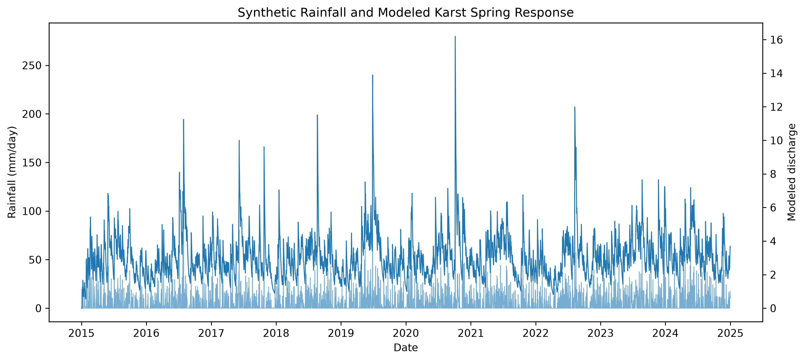
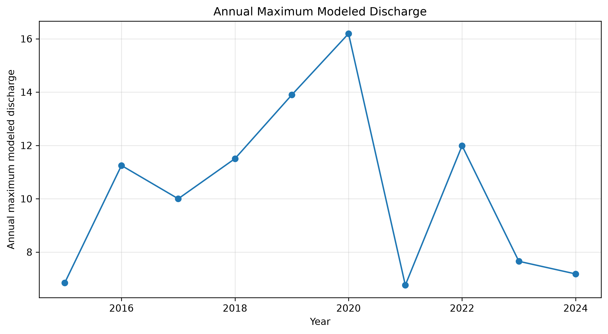
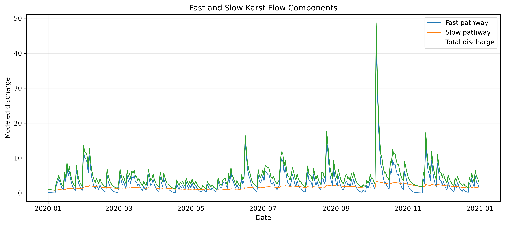
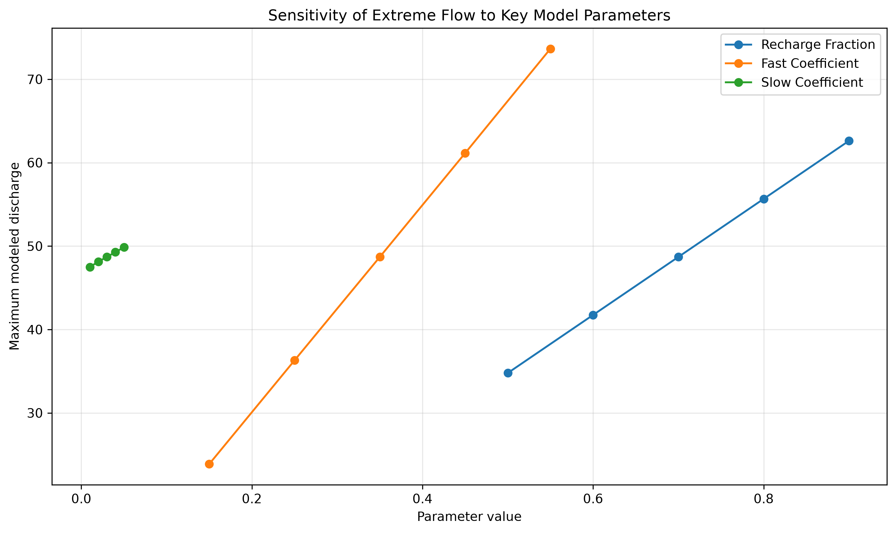

# Conceptual Karst Flow Model: Soft-Data Screening and Extreme-Flow Analysis

A reproducible Python proof-of-concept for exploring how **fast and slow flow pathways in a conceptual karst system** affect simulated discharge and extreme-flow characteristics.

The project combines synthetic rainfall generation, a two-component storage-routing model, qualitative hydrogeological response constraints, parameter sensitivity analysis, and extreme-flow analysis.

> **Important:** This is a synthetic modelling study. It is not a calibrated model of a real karst catchment, and the simulated discharge values are not observed field measurements.

---

## 1. Project overview

Karst aquifers can contain different flow pathways that respond to rainfall at different rates. Preferential or conduit-dominated pathways can produce relatively rapid responses to intense rainfall, while slower storage and matrix-flow components can sustain discharge during recession periods.

This project develops a simplified conceptual model to represent these two behaviours:

```text
                     Synthetic rainfall
                            │
                            ▼
                     Recharge generation
                            │
                  ┌─────────┴─────────┐
                  │                   │
                  ▼                   ▼
          Fast-flow pathway     Slow-flow pathway
          65% of recharge       35% of recharge
                  │                   │
                  ▼                   ▼
           Fast storage          Slow storage
                  │                   │
                  ▼                   ▼
             Fast flow             Slow flow
                  └─────────┬─────────┘
                            │
                            ▼
                    Total discharge
                            │
              ┌─────────────┴─────────────┐
              ▼                           ▼
       Extreme-flow analysis       Sensitivity analysis
```

The purpose is not to reproduce a particular catchment, but to demonstrate a **small, transparent and reproducible modelling workflow** relevant to conceptual karst hydrology.

---

## 2. Research questions

The project addresses three main questions:

1. **How does separating recharge into fast and slow pathways affect simulated discharge?**
2. **How can qualitative hydrogeological information be represented as simple soft constraints on model behaviour?**
3. **How sensitive are simulated high-flow characteristics to the conceptual model parameters?**

---

## 3. Data and synthetic rainfall

The project uses a synthetic daily rainfall series covering:

**1 January 2015 – 31 December 2024**

for a total of **3,653 daily time steps**.

The rainfall generator uses:

* seasonal variability;
* stochastic rainfall generation;
* occasional intense rainfall events;
* a fixed random seed (`42`) for reproducibility.

The generated rainfall series has:

* total rainfall: approximately **22,802.3 mm**;
* maximum daily rainfall: approximately **279.8 mm**.

These values are properties of the synthetic dataset and do not represent rainfall observations from a real catchment.

The rainfall dataset is generated by:

```text
src/generate_rainfall.py
```

and saved as:

```text
data/synthetic_rainfall.csv
```

---

## 4. Conceptual rainfall–flow model

The model is implemented in:

```text
src/karst_model.py
```

It represents the catchment using two conceptual storage components:

### Fast-flow component

The fast component represents a simplified preferential-flow or conduit-like response.

### Slow-flow component

The slow component represents slower storage and release processes, conceptually associated with matrix and longer-residence-time flow.

For each day, rainfall is converted to recharge using:

$$
R_t = P_t f_r
$$

where:

* \(P_t\) = rainfall;
* \(f_r\) = recharge fraction;
* \(R_t\) = recharge.

The recharge is then divided into two pathways:

$$
R_{fast,t}=0.65R_t
$$

$$
R_{slow,t}=0.35R_t
$$

The two components maintain separate storage reservoirs.

For each component, discharge is calculated from storage using a component-specific coefficient:

$$
Q_{fast,t}=k_fS_{fast,t}
$$

$$
Q_{slow,t}=k_sS_{slow,t}
$$

where:

* \(S_{fast}\) and \(S_{slow}\) are the respective storage values;
* \(k_f\) is the fast-flow coefficient;
* \(k_s\) is the slow-flow coefficient.

Total simulated discharge is:

$$
Q_t=Q_{fast,t}+Q_{slow,t}
$$

The model also applies separate maximum storage capacities to the fast and slow reservoirs.

This is a **conceptual storage-routing model**, not a physically based karst groundwater-flow model.

---

## 5. Baseline model parameters

The baseline model uses the following parameter values:

| Parameter             | Value |
| --------------------- | ----: |
| Recharge fraction     |  0.70 |
| Fast-flow coefficient |  0.35 |
| Slow-flow coefficient |  0.03 |
| Fast storage capacity |   100 |
| Slow storage capacity |   500 |

The resulting baseline simulation is saved as:

```text
data/karst_model_output.csv
```

---

## 6. Soft-data parameter screening

### Why screening rather than conventional calibration?

Observed discharge data are not included in this project.

Therefore, the model cannot be calibrated against measured spring discharge or a measured hydrograph.

Instead, the project performs a **soft-data-constrained parameter screening**.

The idea is to represent qualitative hydrogeological information such as:

* relatively rapid response following intense rainfall;
* the occurrence of recession behaviour after events.

These characteristics are evaluated from the simulated response rather than compared against measured discharge observations.

### Screening procedure

The screening uses intense synthetic rainfall events, defined using the **99th percentile of daily rainfall**.

For each parameter combination, two simple response metrics are calculated:

#### Rapid-response metric

For each intense rainfall event, the model examines the following **4-day response window** and calculates the maximum simulated discharge response.

The rapid-response score is based on the resulting mean response relative to the maximum simulated discharge.

#### Recession metric

The model calculates the proportion of daily discharge changes that are non-positive:

$$
\Delta Q_t \leq 0
$$

This is used as a simple indicator of recession behaviour.

The two components are combined into the screening score with equal weighting:

$$
Score=0.5(Response\ Score)+0.5(Recession\ Score)
$$

This is a deliberately simple representation of qualitative information.

It should **not** be interpreted as formal data assimilation, Bayesian calibration, or calibration against field observations.

---

## 7. Screened parameter set

The screening evaluates combinations of:

* 5 recharge-fraction values;
* 5 fast-flow coefficient values;
* 3 slow-flow coefficient values.

This gives **75 parameter combinations**.

The parameter set selected by the implemented screening procedure was:

| Parameter             | Selected value |
| --------------------- | -------------: |
| Recharge fraction     |           0.50 |
| Fast-flow coefficient |           0.15 |
| Slow-flow coefficient |           0.01 |

The resulting screening score was:

**0.5809**

with:

* rapid-response score: **0.4552**;
* recession score: **0.7065**.

The selected model output is written to:

```text
data/calibrated_model_output.csv
```

and the parameter-screening results are written to:

```text
data/calibration_results.csv
```

### Terminology note

The filename `calibrated_model_output.csv` is retained for compatibility with the existing workflow.

Scientifically, the result should be described as a **soft-data-constrained parameter screening result**, not as calibration against observed discharge.

---

## 8. Extreme-flow analysis

The screened model output is analysed using:

* 95th percentile discharge (Q95);
* 99th percentile discharge (Q99);
* maximum simulated discharge;
* annual maximum discharge.

The analysis is performed by:

```text
src/extreme_flow.py
```

### Results

For the 2015–2024 synthetic simulation:

| Metric            | Simulated value |
| ----------------- | --------------: |
| Q95               |           5.495 |
| Q99               |           7.645 |
| Maximum discharge |          16.193 |

The annual maximum discharge values were:

| Year | Annual maximum |
| ---- | -------------: |
| 2015 |          6.842 |
| 2016 |         11.248 |
| 2017 |          9.999 |
| 2018 |         11.506 |
| 2019 |         13.895 |
| 2020 |         16.193 |
| 2021 |          6.758 |
| 2022 |         11.989 |
| 2023 |          7.654 |
| 2024 |          7.180 |

The results are saved in:

```text
data/extreme_flow_summary.csv
```

All discharge values in this analysis are **synthetic model outputs**.

---

## 9. Sensitivity analysis

A separate sensitivity analysis examines how individual conceptual parameters affect simulated discharge characteristics.

The analysis varies one parameter at a time around the baseline configuration.

The parameters examined are:

* recharge fraction;
* fast-flow coefficient;
* slow-flow coefficient;
* fast storage capacity;
* slow storage capacity.

For each tested value, the analysis records:

* Q95;
* Q99;
* maximum discharge;
* mean discharge.

The results are saved as:

```text
data/sensitivity_results.csv
```

Within the tested parameter ranges, the high-flow statistics show stronger changes when varying the **recharge fraction and fast-flow coefficient** than when varying the tested storage capacities.

This result describes the behaviour of this particular conceptual model and parameter ranges. It should not be interpreted as a general statement about all karst systems.

---

## 10. Figures

### Rainfall and simulated discharge



This figure shows the synthetic rainfall forcing together with the resulting simulated discharge through the 2015–2024 modelling period.

### Annual maximum discharge



This figure shows the annual maximum simulated discharge for each year of the modelling period.

### Fast and slow flow components



This figure separates the simulated discharge into the fast and slow components of the conceptual model.

### Parameter sensitivity



This figure illustrates how maximum simulated discharge changes across the tested parameter values.

---

## 11. Reproducible workflow

The complete workflow can be reproduced from the repository root.

### Step 1 — Generate rainfall

```bash
python src/generate_rainfall.py
```

### Step 2 — Run the baseline conceptual model

```bash
python src/karst_model.py
```

### Step 3 — Perform soft-data parameter screening

```bash
python src/calibration.py
```

### Step 4 — Calculate extreme-flow statistics

```bash
python src/extreme_flow.py
```

### Step 5 — Run parameter sensitivity analysis

```bash
python src/sensitivity_analysis.py
```

### Step 6 — Generate the main figures

```bash
python src/make_figures.py
```

### Step 7 — Generate the sensitivity figure

```bash
python src/make_sensitivity_figure.py
```

The workflow is deterministic where the synthetic rainfall generator uses its fixed random seed, allowing the analysis to be reproduced from the source scripts.

---

## 12. Repository structure

```text
karst_soft_data_model/
│
├── data/
│   ├── synthetic_rainfall.csv
│   ├── karst_model_output.csv
│   ├── calibrated_model_output.csv
│   ├── calibration_results.csv
│   ├── extreme_flow_summary.csv
│   └── sensitivity_results.csv
│
├── figures/
│   ├── rainfall_discharge_timeseries.png
│   ├── annual_maximum_discharge.png
│   ├── fast_slow_flow_components.png
│   └── parameter_sensitivity.png
│
├── src/
│   ├── generate_rainfall.py
│   ├── karst_model.py
│   ├── calibration.py
│   ├── extreme_flow.py
│   ├── sensitivity_analysis.py
│   ├── make_figures.py
│   └── make_sensitivity_figure.py
│
├── .gitignore
├── README.md
└── requirements.txt
```

---

## 13. Limitations

This project is intentionally a simplified proof-of-concept.

The main limitations are:

1. **Synthetic rainfall**
   The rainfall series is generated computationally rather than obtained from a real monitoring station.

2. **No observed discharge**
   The model has not been evaluated against measured spring or stream discharge.

3. **No site-specific calibration**
   The selected parameter set results from conceptual soft-data screening rather than calibration to observations.

4. **Simplified karst representation**
   The model represents fast and slow pathways using two storage reservoirs rather than an explicit karst conduit network.

5. **Simplified soft-data representation**
   Qualitative hydrogeological information is represented using simple response metrics rather than measured hydrograph characteristics.

6. **Synthetic discharge units**
   The simulated discharge values are model outputs and should not be interpreted as field measurements with a site-specific physical unit.

7. **Limited sensitivity analysis**
   The parameter sensitivity experiment explores selected parameter ranges and does not provide a full probabilistic uncertainty analysis.

8. **No climate projection**
   The project does not simulate future climate scenarios or make climate-change projections.

---

## 14. Future development

A more advanced version of this framework could incorporate:

* observed rainfall and spring-discharge observations;
* site-specific hydrogeological information;
* geological and structural controls;
* formal calibration against observed hydrographs;
* multi-objective calibration of peak response and recession behaviour;
* probabilistic parameter estimation;
* explicit uncertainty propagation;
* physically based groundwater-flow modelling;
* application to a real karst catchment.

These extensions would allow the conceptual proof-of-concept to be evaluated against observations and developed into a site-specific modelling framework.

---

## 15. Technologies

The project uses:

* **Python**
* **NumPy**
* **pandas**
* **Matplotlib**

The required Python packages are listed in:

```text
requirements.txt
```

---

## 16. Project significance

This project provides a compact example of a reproducible hydrogeological modelling workflow that connects:

**rainfall forcing → conceptual recharge pathways → fast/slow storage → simulated discharge → soft-data screening → extreme-flow analysis → parameter sensitivity**

The emphasis is on making the modelling assumptions explicit and keeping the workflow sufficiently simple that each modelling step can be inspected and reproduced.
